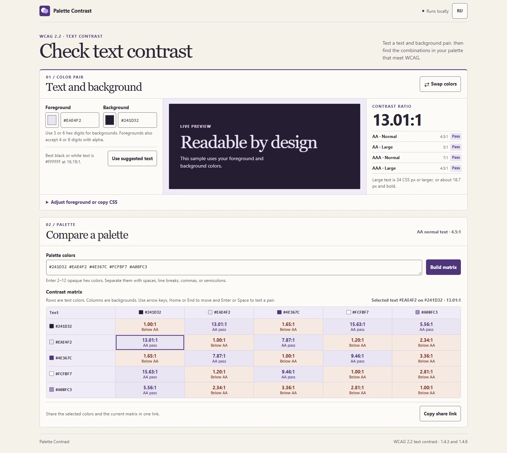

# Palette Contrast

[English](#english) · [Русский](#русский)

## English

Check text and background colors, then compare an entire palette before using it in an interface. Palette Contrast runs in the browser with no runtime dependencies.

### Use the tool

**[Try it here](https://orangepony4.github.io/palette-contrast/)** · [Get the offline ZIP from the latest release](https://github.com/orangepony4/palette-contrast/releases/latest)

For offline use, extract the ZIP and open `index.html`. Enter text and background colors in hex or use the native color pickers. The preview and contrast checks update as you type. The app opens in English on the first visit. Select **RU** in the header to show your current pair and matrix in Russian.

- The text color accepts `#RGB`, `#RGBA`, `#RRGGBB`, and `#RRGGBBAA`. A translucent text color is composited over the selected opaque background.
- Paste two to twelve different opaque colors, separated by spaces, newlines, commas, or semicolons, to build a palette matrix. Rows are text colors and columns are backgrounds.
- Select a cell to apply the pair. In the matrix, use the arrow keys to move, Home and End to reach row edges, and Enter or Space to apply.
- Try black or white text, swap opaque colors, or copy the selected pair as CSS.
- To keep a similar foreground, choose a threshold and select **Adjust text color**. The tool mixes the current color toward black or white by the smallest tested amount that passes, while keeping its opacity and the background.
- Use **Copy share link** to share the current pair and built matrix. The colors are stored in the URL fragment and the app makes no network request when you copy the link.
- When you follow a share link in the same tab, going back to the plain tool URL restores your editable draft. Going forward opens the shared colors again.

### How the checks work

The app uses the WCAG 2.2 sRGB relative-luminance formula and compares the full-precision ratio with the threshold. It rounds down only for display.

| Text size | AA | AAA |
| --- | --- | --- |
| Normal | 4.5:1 | 7:1 |
| Large | 3:1 | 4.5:1 |

Large text is at least 18 points at regular weight or 14 points in bold. These checks cover solid sRGB color pairs. Actual legibility also depends on the font, size, and rendering. [WCAG 2.2 text contrast](https://www.w3.org/TR/WCAG22/#contrast-minimum)

### Development

Run `npm test` with Node.js 20 or newer. The test suite covers hex parsing, luminance, alpha compositing, unrounded threshold decisions, foreground adjustment, palette parsing, and share links.

Released under the [MIT License](LICENSE).

---

## Русский

Проверьте контраст текста и фона или сравните всю палитру для интерфейса. Palette Contrast работает в браузере без дополнительных зависимостей.

### Как пользоваться

**[Попробовать здесь](https://orangepony4.github.io/palette-contrast/)** · [Скачать ZIP для работы без интернета](https://github.com/orangepony4/palette-contrast/releases/latest)

Распакуйте ZIP и откройте `index.html`, чтобы работать без интернета. Введите HEX-цвета текста и фона или выберите их в палитре браузера. Предпросмотр и результаты обновляются при вводе. При первом открытии интерфейс на английском. Кнопка **RU** в шапке показывает текущую пару и таблицу на русском.

- Для текста подходят `#RGB`, `#RGBA`, `#RRGGBB` и `#RRGGBBAA`. Полупрозрачный цвет текста накладывается на непрозрачный фон.
- Введите от 2 до 12 разных непрозрачных цветов через пробел, перенос строки, запятую или точку с запятой. В строках таблицы будут цвета текста, в столбцах — цвета фона.
- Чтобы проверить пару, выберите ячейку. В таблице можно перемещаться стрелками, переходить к краям строки клавишами Home и End и применять пару клавишей Enter или пробелом.
- Программа подскажет, чёрный или белый текст лучше виден на выбранном фоне. Непрозрачные цвета можно поменять местами, а текущую пару скопировать как CSS.
- Для подбора похожего цвета выберите минимальный контраст и нажмите **Подобрать цвет текста**. Программа приблизит цвет к чёрному или белому и сохранит его прозрачность.
- Кнопка **Копировать ссылку** сохраняет выбранную пару и текущую таблицу в адресе. При копировании приложение не отправляет сетевой запрос.
- Если открыть ссылку с палитрой в той же вкладке, переход назад к обычному адресу вернёт ваши черновые значения. Переход вперёд снова откроет цвета из ссылки.

### Как рассчитывается контраст

Программа использует формулу относительной яркости sRGB из WCAG 2.2. Проверка сравнивает точное значение с порогом. Округление вниз применяется только при отображении.

- Обычный текст соответствует AA при контрасте от 4,5:1 и AAA от 7:1.
- Крупный текст соответствует AA при контрасте от 3:1 и AAA от 4,5:1.

Крупный текст — от 18 пунктов при обычном начертании или от 14 пунктов при полужирном. Проверка работает с однотонными цветами sRGB. Читаемость также зависит от шрифта, размера и отрисовки. [Контраст текста по WCAG 2.2](https://www.w3.org/TR/WCAG22/#contrast-minimum)

### Разработка

Запустите `npm test` в Node.js 20 или новее. Тесты проверяют разбор HEX-цветов, яркость, прозрачность, расчёт порогов, подбор цвета, палитру и ссылки.

Проект распространяется по [лицензии MIT](LICENSE).
